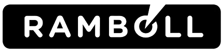

**An interactive knowledge base that links the spatial challenges of logistics architecture to measurable goals, thematic domains, evidence workflows and computational tools.** It is built from the student projects of the *Rethinking.Logistics* studio at ARCHIP Prague (2026), from expert lectures and from projects in practice.

*Edition 1.0* · {{count:ambition}} ambitions · {{count:challenge}} challenges · {{count:metric}} metrics · {{count:tool}} tools · {{count:case-study}} case studies · {{count:reference}} reference projects · {{count:domain}} domains · {{count:strategy}} strategies · {{count:insight}} insights, each with its [[Evidence status|evidence status]]

## From problem to solution

The knowledge base is a network: one domain addresses several challenges, one tool calculates many metrics, and one challenge involves trade-offs across domains. To find your way through it, follow the **Extended Double Diamond** — from the problem, through a measurable goal, to a solution.

![[Extended Double Diamond.png]]
*Extended Double Diamond Diagram: Lukáš Kurilla*

| Phase | The question | In the knowledge base |
| --- | --- | --- |
| **Discover · Gather** → *ideas and insights* | What do experts, students and publications tell us about the problem? | **Insights** — {{count:insight}} single statements, each with its source and evidence status, from {{count:source}} lectures, questionnaires and publications. See [[Insights overview]]. |
| **Define · Analyse** → *from ambitions to the goal: challenges and evidence (KPI)* | What should the project achieve, which spatial problem stands in its way, and how will we know the design is better? | **Ambitions** — {{count:ambition}} aims the student projects pursue, taken from how the students framed their briefs, e.g. [[Mixed use and function stacking]] or [[Shared waste heat]]. **Challenges** — the specific architectural and urban problems of logistics sites, e.g. [[Waste heat and cooling of data centres]] or [[Stormwater and sealed surfaces on logistics sites]]. **Metrics** — measurable indicators (students often call them KPIs), each with a unit and a calculation method, e.g. [[Biotope area factor]] or [[Embodied carbon intensity]]. See [[Ambitions overview]], [[Challenge map]] and [[Metric catalogue]]. |
| **Develop · Evaluate** → *concepts and performance* | How was it designed, and how was its performance calculated? | **Case studies** — student projects with their metrics, values, trade-offs and decisions. **Domains** — five thematic domains the studio worked in, families of design concepts synthesised from the case studies, with their trade-offs and evidence gaps, e.g. [[Regenerative Peripheral Park]] or [[Energy Symbiosis]]. **Tools** — the software that calculates the metrics, e.g. [[Ladybug]], [[Karamba3D]] or [[One Click LCA]]. See [[Case studies overview]], [[Domains]] and [[Tool directory]]. |
| **Deliver · Optimise** → *strategy and impact* | Which approach works, and where is it already built? | **Strategies** — {{count:strategy}} evidence workflows found in the projects: which metrics to calculate, with which tool or method, and the decision it led to, e.g. [[Reuse versus new-build carbon comparison]] or [[Wind simulation for sheltered layouts]]. **Reference projects** — logistics projects from practice, e.g. [[Nexus Logistics Park]]. See [[Strategies]] and [[Reference projects overview]]. |

## Start here

Different readers enter the network through different doors.

**Through ambitions** — *for cities and clients.* You know what you want to achieve, such as mixed use or rainwater kept on site, and want to see which challenges, projects and domains serve that aim. → **[[Ambitions overview]]**

**Through challenges** — *for developers and planners.* You have a concrete problem, such as waste heat from a data centre, and want to know what to measure and which approaches address it. → **[[Challenge map]]**

**Through domains** — *for architects.* You are looking for a theme the studio explored, the approaches tested in it, their trade-offs and the evidence behind them. → **[[Domains]]**

**Through strategies, metrics and tools** — *for computational designers.* You want to know how the projects got from a metric to a decision, or which metrics a piece of software can calculate, for example life-cycle assessment inside Grasshopper with [[Bombyx]]. → **[[Strategies]]**, **[[Metric catalogue]]** and **[[Tool directory]]**

**Through projects** — *for inspiration.* You want to see the whole chain at work, from a problem to a result. → **[[Case studies overview]]** and **[[Reference projects overview]]**

Also useful: which metrics pull against each other in [[Trade-offs]], and where evidence is still missing in [[Evidence gaps]]. Use the **search** (top left): it ignores accents, finds parts of words and tolerates small typos.

## How everything connects

Every type of note and every link between them, drawn from the structure of the knowledge base. The numbers are the notes published today.

{{schema-diagram}}

## Support and partners

Rethinking.Logistics is funded by **Rambøll Fonden (Ramboll Foundation)**. The studio was led by Lukáš Kurilla and Šimon Prokop at ARCHIP – Architectural Institute in Prague, in collaboration with:

<ul class="rl-logos"><li></li><li></li><li></li><li></li><li></li></ul>
